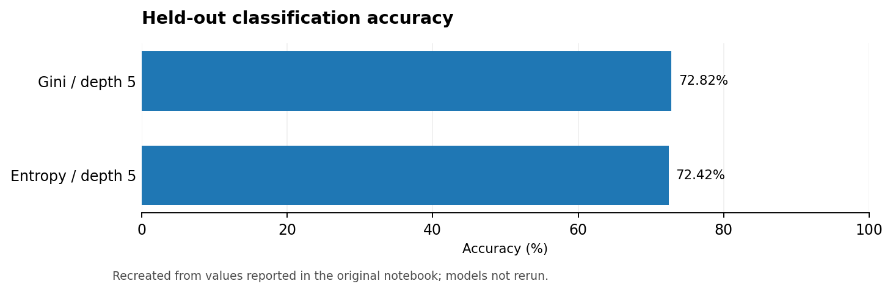

# League of Legends Match Outcome Prediction

**Type:** Machine learning course project · **Task:** Binary classification · **Main contribution:** Implement a decision tree algorithm within provided assignment scaffolding.

## Overview

Predict whether the blue side wins a ranked *League of Legends* match using game-state indicators from the first 10 minutes. The source dataset contains **9,879 matches** and 38 team-level features (19 per side), plus the match ID and target variable `blueWins`.

## Methods and implementation

- Inspected the dataset and removed redundant columns (including symmetric gold/experience differences and per-minute statistics).
- Engineered blue-minus-red feature differences.
- Discretized higher-cardinality features using quantile bins.
- Implemented a decision tree with **Gini impurity or entropy**, weighted information gain, candidate threshold selection, recursive binary splitting, stopping rules, and tree traversal for prediction.
- Compared depth, minimum split size, and impurity options using cross-validation.

## Notebook-reported results

| Setting | Held-out accuracy |
| --- | ---: |
| Depth 5, min split 10, Gini | **0.7282** |
| Depth 5, min split 2, Entropy | 0.7242 |

The notebook describes the entropy configuration as having a mean cross-validation accuracy of approximately **0.7267**. These numbers are retained from saved notebook outputs and **have not been rerun or independently verified**.

## Dataset and running

Source: [Kaggle — League of Legends Diamond Ranked Games (10 min)](https://www.kaggle.com/datasets/bobbyscience/league-of-legends-diamond-ranked-games-10-min)

Download `high_diamond_ranked_10min.csv` and place it at `data/high_diamond_ranked_10min.csv`. Start Jupyter in this project directory; open [`notebooks/lol_win_prediction.ipynb`](notebooks/lol_win_prediction.ipynb). The notebook references `./data/`, so its working directory must be the project root.

## Limitations and possible improvements

- **Data leakage risk:** quantile bin edges are calculated on the full dataset *before* the train/test split. A more rigorous workflow would fit bins on training folds only and apply them to validation/test folds.
- Feature-engineering and hyperparameter-selection steps should be packaged into a reproducible training/validation pipeline.
- Performance is reported for one held-out split; add a truly untouched test set and compare against a standard library baseline.
- Computational efficiency of candidate threshold search can be improved.

## Attribution

Educational assignment based on supplied teaching material. The notebook preserves the original task description and scaffolding with completed algorithm code and experimental analysis.

## Notebook language editions

- [English-facing notebook](notebooks/lol_win_prediction.ipynb): compact English narrative and English-normalized source annotations where possible.
- [Original submitted notebook](archive/original_notebook.ipynb): original Chinese descriptions and unmodified code and outputs for traceability.

### Performance snapshot

*English chart reconstructed from the original notebook-reported numbers; not a fresh model evaluation.*

