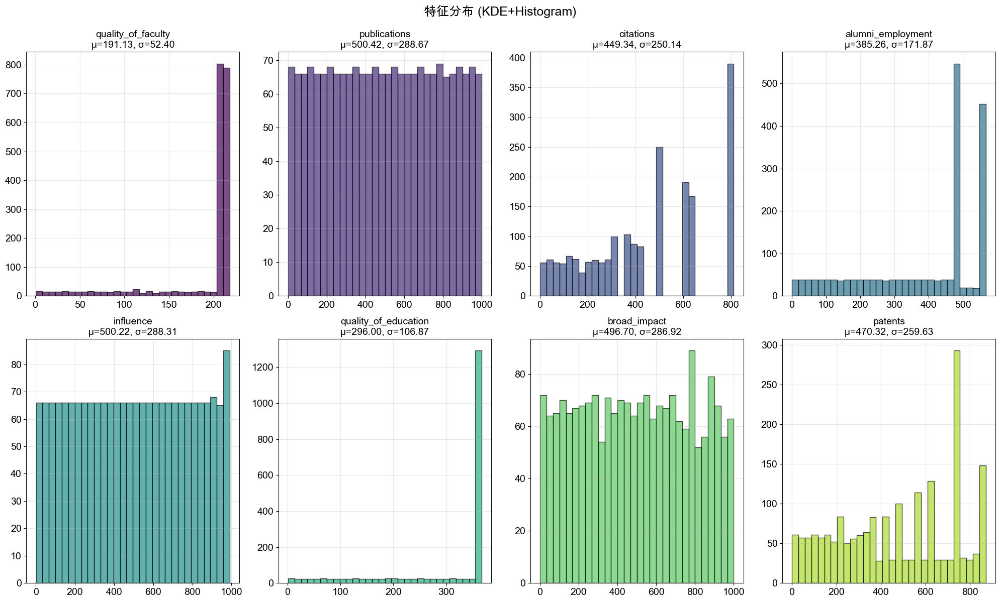
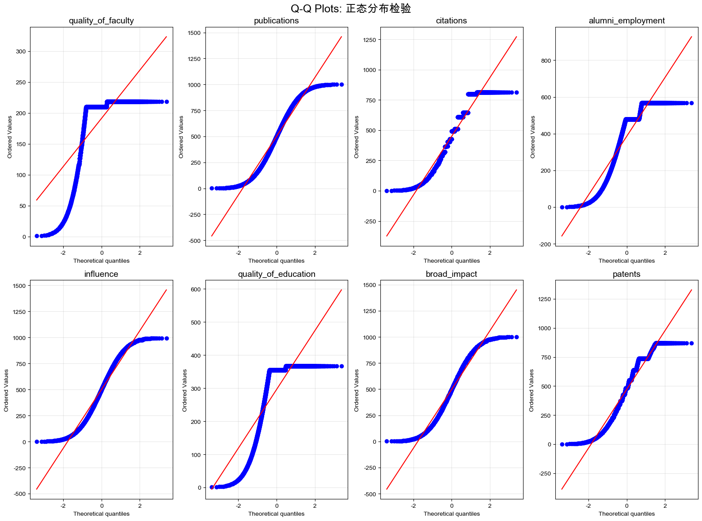
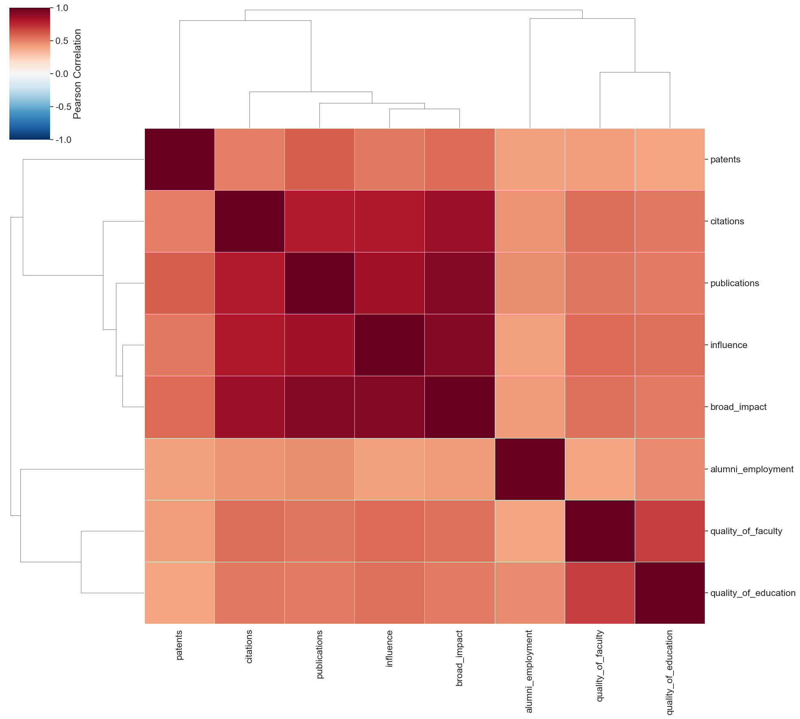

# University Score Prediction with Regression Models

**Type:** Machine learning course project · **Task:** Supervised regression · **Dataset:** CWUR university ranking data.

## Overview

Use eight academic/ranking indicators to predict a university's overall CWUR score. The original analysis drops incomplete records, leaving **2,000 observations**. It explores distributional shape, correlations, principal components, model regularization, feature transformations, and geographic categorical features.

## Workflow

- Exploratory data analysis: descriptive statistics, histograms, Q–Q plots, correlation clustering, and scatterplots.
- Linear regression baselines; comparison of **Ridge**, **Lasso**, and principal-component regression.
- Cross-validation to select Ridge regularization strength.
- Experiments with log, square-root and other nonlinear transformations.
- One-hot encoding of region and experiments averaging records by institution.

## Notebook-reported results

| Model | R² | RMSE |
| --- | ---: | ---: |
| Log-transformed features + RidgeCV | **0.701** | **2.236** |
| Log + RidgeCV + region | 0.697 | 2.252 |
| Institution-aggregated log + RidgeCV + region | 0.884 | 3.278 |

The preferred **record-level** configuration is log-transformed features with RidgeCV (reported alpha ≈ **25.60**). Values are taken from saved notebook output and **have not been independently reproduced**.

**Important:** the institution-aggregated experiment changes the sample and target distribution; therefore its R² and RMSE are **not directly comparable** with row-level experiments. A larger R² there does not establish that it is a better row-level predictor.

## Dataset and running

Source: [Kaggle — World University Rankings (CWUR)](https://www.kaggle.com/datasets/mylesoneill/world-university-rankings)

Download `cwurData.csv` and place it at `data/cwurData.csv`. Start Jupyter from the project root and open [`notebooks/university_score_regression.ipynb`](notebooks/university_score_regression.ipynb). The original notebook expects `./data/cwurData.csv` relative to its working directory.

Install shared dependencies with `pip install -r ../requirements.txt` from this project directory.

## Limitations and possible improvements

- Repeated observations for the same university across years could put closely related records on both sides of a random train/test split. Consider **institution-grouped or time-aware evaluation** for deployment-like claims.
- The exploratory PCA step is fitted on all observations; if used in model evaluation, fit PCA inside each training fold.
- Some transformations/scaling are applied before RidgeCV cross-validation, which can leak validation-fold information during hyperparameter selection. Use `Pipeline` and fold-specific preprocessing.
- Reevaluate all candidate models under a consistent dataset, split, and metric, with a single untouched test set.
- Ranking indicators can be highly correlated; regression coefficients should not be interpreted causally.

## Attribution

Educational project based on externally supplied assignment instructions and CWUR data. The notebook retains the instructional material alongside submitted analyses and code.

## Visual results from original experiments

*Historical notebook outputs, not freshly reproduced.*

## Notebook language editions

- [English-facing notebook](notebooks/university_score_regression.ipynb): compact English narrative and English-normalized source annotations where possible.
- [Original submitted notebook](archive/original_notebook.ipynb): original Chinese descriptions and unmodified code and outputs for traceability.
