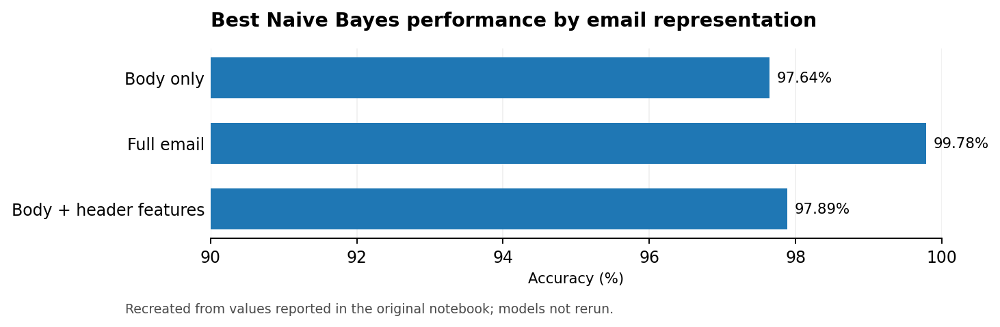
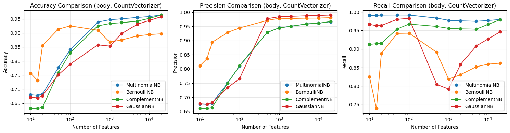

# Naive Bayes Spam Detection

> **NLP · Binary classification · Text vectorization · Probabilistic models**

## Project at a glance

| Dataset | Main methods | Evaluation | Notebook-reported best |
|:--|:--|:--|:--|
| TREC 2006 Chinese email corpus (64,620 emails) | TF-IDF / counts + Naive Bayes variants | Accuracy, precision, recall | **99.78% accuracy** using full email text |

## Research question

How much does access to email headers improve spam filtering compared with the message body alone? This experiment evaluates three email representations: **body**, **full email** and **body plus 11 handcrafted header features**. Two vectorizers (CountVectorizer and TfidfVectorizer) are paired with Multinomial, Bernoulli, Complement and Gaussian Naive Bayes.

### Performance snapshot

*English chart reconstructed from the original notebook-reported numbers; not a fresh model evaluation.*

## Results

| Input representation | Best vectorization / classifier | Accuracy | Precision | Recall |
|:--|:--|--:|--:|--:|
| Body only | TF-IDF + GaussianNB | 97.64% | 98.89% | 97.54% |
| **Full email (header + body)** | **TF-IDF + GaussianNB** | **99.78%** | **99.83%** | **99.84%** |
| Body + handcrafted header features | TF-IDF + GaussianNB | 97.89% | 99.19% | 97.61% |

## Visual results

*Plot exported from the original notebook; titles/labels may remain in Chinese as part of the saved historical output.*

## Implementation

The notebook decodes email content, extracts headers, builds sparse text representations, and benchmarks classifier/feature combinations. See [English-facing notebook](notebooks/spam_classification.ipynb) and [original submitted notebook](archive/original_notebook.ipynb).

## Limitations and reproducibility

- The **original email corpus is not included**. Obtain the TREC 2006 corpus and preserve its labeling scheme and directory hierarchy.
- Very high performance with full headers may reflect dataset-specific artifacts or leakage-prone metadata. Validate on chronologically separate messages or another corpus before generalizing.
- Notebook outputs are historical and **not independently rerun**; full corpus training may require substantial memory.
- The English-facing notebook condenses Chinese narrative; Python source, essential string literals, and saved outputs are retained.

**Source:** [TREC 2006 spam corpus](https://plg.uwaterloo.ca/~gvcormac/treccorpus06/).
