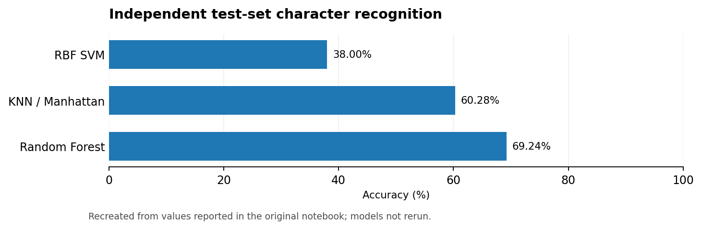
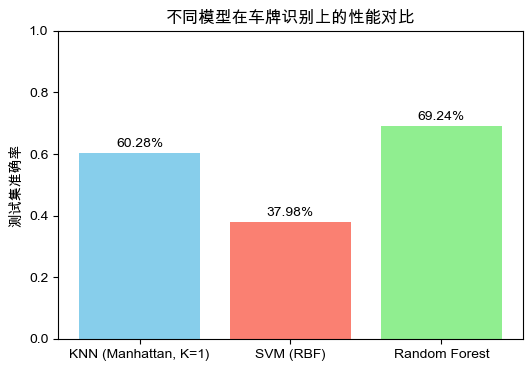
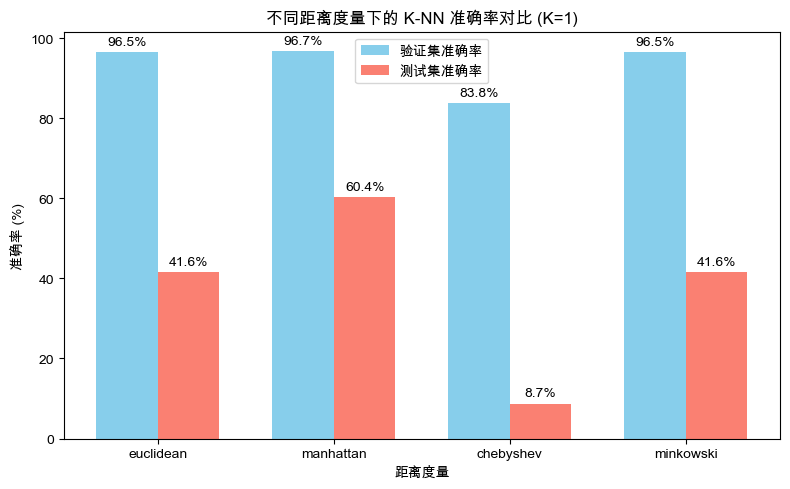

# License Plate Character Recognition

> **Computer vision · K-nearest neighbors · SVM · Random forest**

## Project at a glance

| Task | Data representation | Models | Notebook-reported best result |
|:--|:--|:--|:--|
| Classification of pre-segmented plate characters | 20 × 20 grayscale character images | KNN, RBF SVM, Random Forest | **69.24% test accuracy — Random Forest** |

## Problem and approach

This experiment recognizes **already segmented plate characters** (not full-plate detection or OCR). The assignment describes 65 character categories: digits, Latin letters excluding I/O, and Chinese province abbreviations. Each sample is represented as a pixel vector. Experiments vary nearest-neighbor count, distance metrics and voting weights, then compare against an RBF SVM and a tuned random forest.

### Performance snapshot

*English chart reconstructed from the original notebook-reported numbers; not a fresh model evaluation.*

## Performance overview

| Model / setting | Reported independent test accuracy |
|:--|--:|
| KNN, best Manhattan experiment | 60.28% |
| RBF SVM, tested configuration | ~38% |
| **Random Forest** | **69.24%** |

### Visual comparison

*Figures are taken directly from saved notebook outputs; some axes may retain original Chinese labels.*

## What I explored

- Image loading and pixel vectorization
- Neighbor count and Euclidean, Manhattan, Chebyshev and Minkowski metrics
- Uniform vs. distance-weighted KNN
- Learning curves and dataset size sensitivity
- SVM and random-forest baselines and feature-importance visualization

## Critical finding

**Validation accuracy was substantially higher than independent test accuracy.** That discrepancy may reflect train/test distribution shift or memorization; the results should not be interpreted as production-ready OCR performance. Earlier notebook sections also inspect test accuracy across several K values; the more principled validation-set tuning should be preferred.

## Reproduce

This repository does not contain the source character images. Place the originally provided split folders under `data/train/<label>/...` and `data/test/<label>/...`; start Jupyter from this project root. See the [English-facing notebook](notebooks/license_plate_recognition.ipynb) or [original notebook](archive/original_notebook.ipynb).
