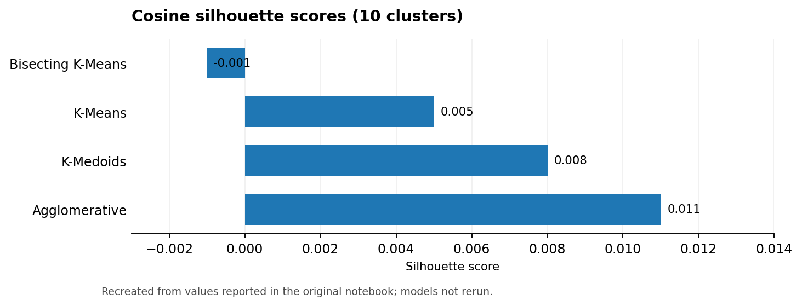
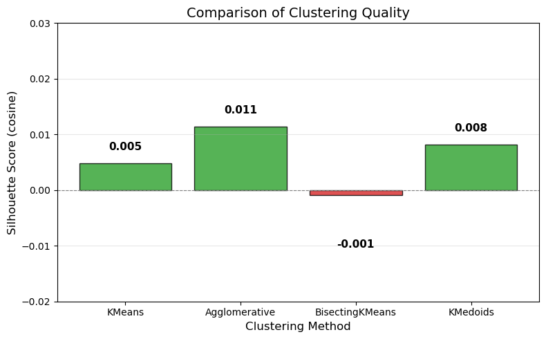
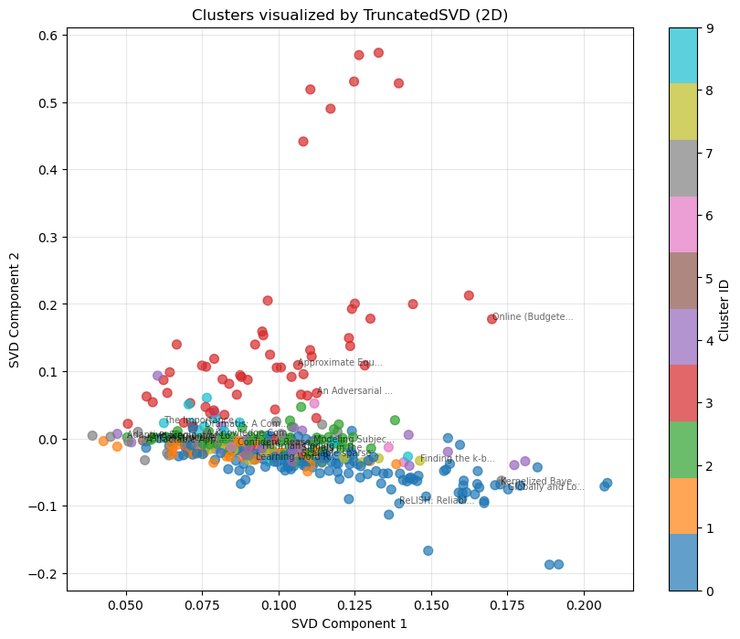

# Clustering AAAI 2014 Research Papers

> **Unsupervised learning · NLP · TF-IDF · Hierarchical clustering · Dimensionality reduction**

## Project at a glance

| Corpus | Features | Cluster models | Selection criterion |
|:--|:--|:--|:--|
| ~400 AAAI 2014 accepted papers | TF-IDF from title / abstract / keywords, plus author tokens | K-Means, agglomerative, bisecting K-Means, K-Medoids | Cosine silhouette + topic inspection |

## Research question

Can unsupervised methods recover interpretable research themes from paper metadata? The workflow combines tokenized paper content and normalized author features, builds 10 clusters per algorithm, inspects topic coherence and visualizes low-dimensional embeddings with TruncatedSVD, PCA and t-SNE.

### Performance snapshot

*English chart reconstructed from the original notebook-reported numbers; not a fresh model evaluation.*

## Reported clustering results

| Model | Cosine silhouette score |
|:--|--:|
| K-Means | 0.005 |
| **Agglomerative clustering** | **0.011** |
| Bisecting K-Means | -0.001 |
| K-Medoids | 0.008 |

The **near-zero silhouette scores** suggest weakly separated topics, even for the comparatively best agglomerative model. Qualitative labeling is subjective and was not checked against a ground-truth taxonomy.

## Visual exploration

*Charts extracted from saved experiment outputs.*

## Pipeline

`Paper metadata → text normalization → TF-IDF + author features → L2 normalization → clustering → cluster inspection → SVD/PCA/t-SNE`

## Reproduce

Dataset: [UCI — AAAI 2014 Accepted Papers](https://archive.ics.uci.edu/dataset/307/aaai+2014+accepted+papers). Download the CSV into `data/` and check the `DATA_DIR` setting in the notebook (the original path includes the dataset filename). The dataset is not redistributed here.

[English-facing notebook](notebooks/aaai_paper_clustering.ipynb) · [Original submission](archive/original_notebook.ipynb)
