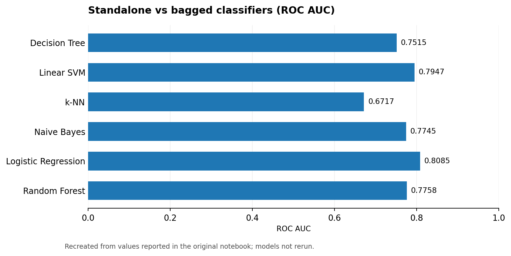
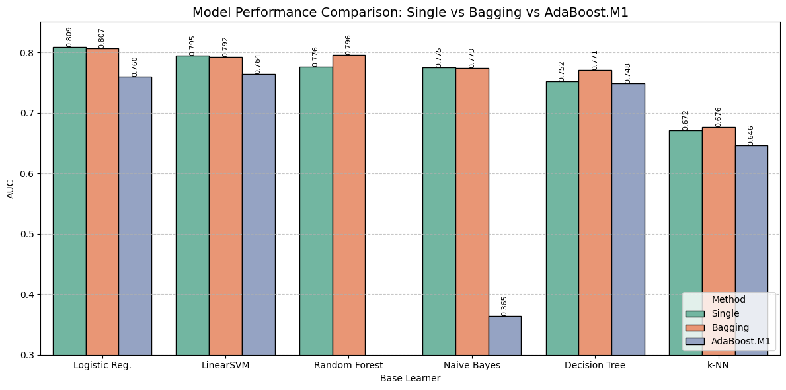
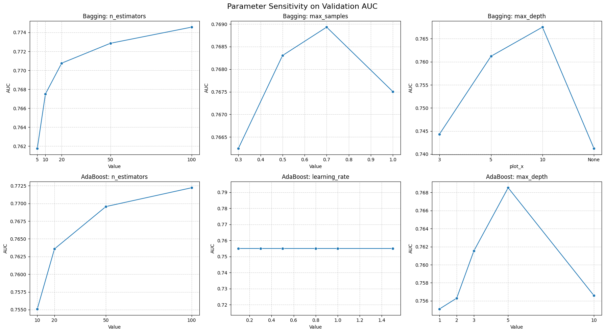

# Amazon Review Quality Prediction with Ensemble Learning

> **Text classification · Bagging · AdaBoost.M1 · Model benchmarking**

## Project at a glance

| Dataset | Objective | Implementations | Metric |
|:--|:--|:--|:--|
| 50,000+ Amazon reviews (assignment dataset) | Predict review quality from review text / overall rating | Manual Bagging and AdaBoost.M1 plus scikit-learn baselines | ROC AUC |

## Motivation

Can ensembling improve review-quality classification when the input combines high-dimensional text with a strong numerical rating feature? The experiment implements custom **`ManualBaggingClassifier`** and **`ManualAdaBoostM1Classifier`**, compares multiple base estimators and studies feature representations and hyperparameters.

### Performance snapshot

*English chart reconstructed from the original notebook-reported numbers; not a fresh model evaluation.*

## Results from the original notebook

| Base learner | Standalone AUC | Bagging AUC | AdaBoost.M1 AUC |
|:--|--:|--:|--:|
| Decision Tree | 0.7515 | 0.7709 | 0.7483 |
| Linear SVM | 0.7947 | 0.7920 | 0.7642 |
| k-NN | 0.6717 | 0.6764 | 0.6459 |
| Naive Bayes | 0.7745 | 0.7734 | 0.3645 |
| **Logistic Regression** | **0.8085** | 0.8067 | 0.7595 |
| Random Forest | 0.7758 | 0.7960 | — |

A later decision-tree tuning experiment reported **Bagging AUC 0.7766** and **AdaBoost AUC 0.7778**. These are **not** the overall best results across all model families; the strongest standalone baseline above was logistic regression at 0.8085.

## Experimental plots

*Original saved plots; Chinese text in historical output images has not been re-rendered.*

## Key takeaways

- Bagging can help unstable base estimators such as decision trees, but does not uniformly improve strong linear classifiers.
- The `overall` rating supplies strong predictive signal; interpretation depends on how “quality” is labeled and whether the rating is permissible at prediction time.
- AdaBoost.M1 is sensitive to weak learner assumptions and noisy text features; its results differ substantially by classifier.

## Reproduction and limitations

The Amazon assignment dataset is **not included**; re-running requires the original training/test files. Check file paths, packages and label definition in the notebook. All performance metrics here are **notebook-reported, not rerun**. The original assignment descriptions and detailed Chinese analysis are retained in the [archive](archive/original_notebook.ipynb).

[English-facing notebook](notebooks/amazon_review_quality.ipynb)
