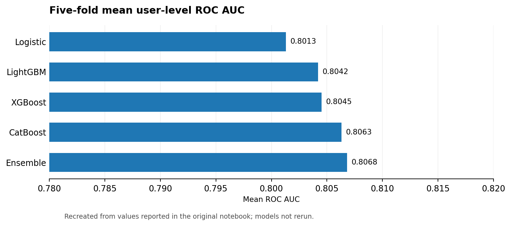
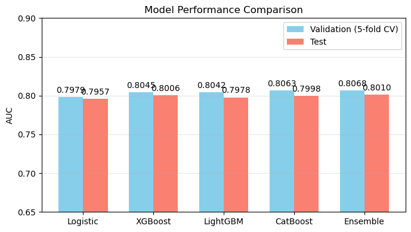
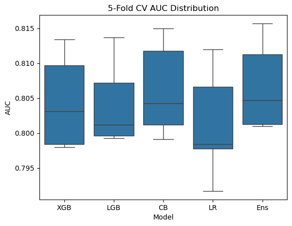
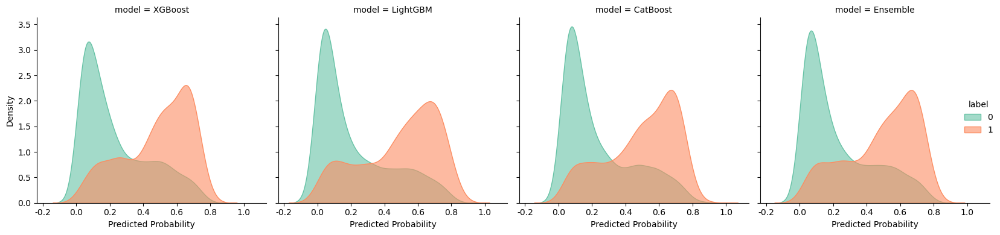

# Mobile Game User Churn Prediction

> **End-to-end ML · Behavioral feature engineering · Gradient boosting · Grouped CV · Calibration**

## Project at a glance

| Prediction task | Models explored | Evaluation design | Reported result |
|:--|:--|:--|:--|
| User-level churn from game-level behavioral logs | Logistic regression, XGBoost, LightGBM, CatBoost, MLP, GRU, ensemble | User-level ROC AUC; 5-fold GroupKFold | **0.8068 mean CV AUC** for the ensemble |

## Problem

Predict whether a player will churn from an anonymized level-based mobile game using gameplay attempts, timestamps, level characteristics, failed retries and progression patterns. This final course project studies the whole modeling pipeline rather than a single estimator.

## Pipeline

```text
Gameplay events + level metadata
               │
               ▼
 Cleaning, temporal normalization, deduplication
               │
               ▼
 User–level aggregates + level–user cross features
               │
               ▼
 Behavioral trends, failure streaks, recency
               │
               ▼
 Feature selection + hyperparameter optimization
               │
               ▼
 XGBoost / LightGBM / CatBoost / Logistic / GRU
               │
               ▼
 Grouped cross-validation → weighted ensemble
               │
               ▼
 User-level AUC + probability calibration
```


### Performance snapshot



*English chart reconstructed from the original notebook-reported numbers; not a fresh model evaluation.*

## Validation performance

*Five-fold cross-validation means as recorded in the notebook:*

| Model | Mean ROC AUC |
|:--|--:|
| Logistic Regression | 0.8013 |
| XGBoost | 0.8045 |
| LightGBM | 0.8042 |
| CatBoost | 0.8063 |
| **Tree Ensemble** | **0.8068** |

The notebook separately reports an ensemble **test AUC of approximately 0.8010**. The CV gain over CatBoost is only ~0.0005, and **should not be described as statistically significant without an appropriate test**.

## Selected visual results







*Figures extracted from the submitted notebook and not independently re-created.*

## Highlights

- Engineered recency, attempt-frequency, time-of-day, failure-streak, trend and level-difficulty features.
- Compared supervised, neural and clustering-assisted approaches.
- Tuned models and selected 100 high-importance features in one experimental branch.
- Evaluated grouped cross-validation to avoid assigning the same user to both training and validation folds.
- Examined score distributions and probability calibration (ECE / Brier score).
- Investigated stacking; the notebook concluded that it did **not** reliably improve generalization.

## Methodological caveats

- Several notebook sections are exploratory and use hard-coded summary tables alongside model-generated results; identify those separately rather than assuming a single reproducible run.
- A function named `delong_roc_test` in the original notebook describes bootstrap testing in its docstring; its statistics should **not** be advertised as a validated DeLong implementation without auditing.
- Calibration does not guarantee high recall at a default 0.5 threshold; decision thresholds should be chosen based on churn intervention costs.
- The underlying assignment datasets are **not redistributed**, and running end to end requires them, the original directory structure and optional heavy ML libraries.

**Notebook:** [English presentation edition](notebooks/mobile_game_churn.ipynb) · [Complete original submission](archive/original_notebook.ipynb)
