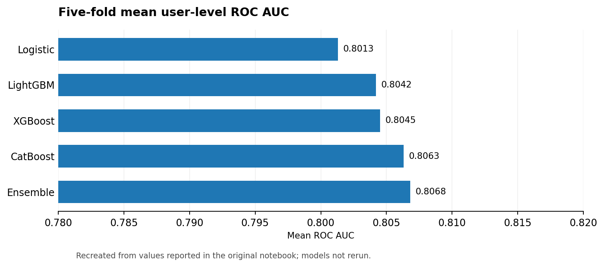
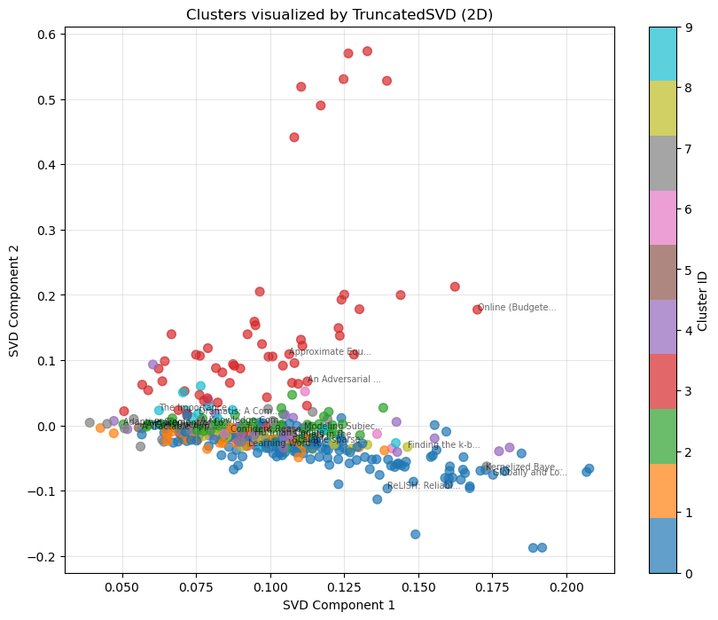
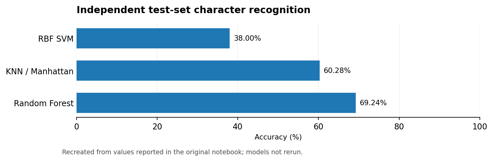
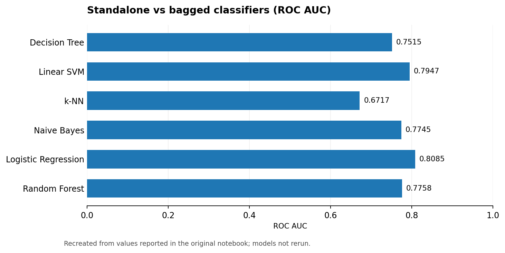
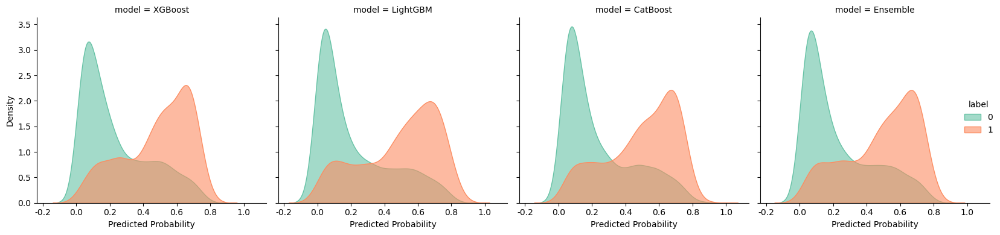

# Machine Learning Projects

**A curated portfolio of machine learning projects, from first-principles algorithms to end-to-end behavioral prediction.**

`Python` · `scikit-learn` · `Pandas` · `NLP` · `Computer Vision` · `Gradient Boosting` · `Model Evaluation`

This repository brings together seven **educational / course-based projects**. Each project contains a concise English case study, an English-facing Jupyter notebook, and the unmodified original submission for reference. Experiments emphasize **feature engineering, implementation, evaluation, reproducibility and critical interpretation** rather than simply maximizing a headline metric.

## Featured project

### [Mobile Game User Churn Prediction](07-mobile-game-churn-prediction/)

An end-to-end behavioral ML pipeline incorporating gameplay logs, multi-level feature aggregation, boosted trees, grouped cross-validation, ensembling and model calibration.

**Notebook-reported 5-fold mean ensemble ROC AUC: 0.8068.**



## Explore the projects

| Project | Primary techniques | Historical headline metric |
|:--|:--|:--|
| **[01 · League of Legends Win Prediction](01-league-of-legends-win-prediction/)** | From-scratch decision tree, information gain | **72.82%** held-out accuracy |
| **[02 · University Score Regression](02-university-score-regression/)** | Ridge/Lasso, PCA, transformations, EDA | **RMSE 2.236 / R² 0.701** |
| **[03 · Naive Bayes Spam Classification](03-naive-bayes-spam-classification/)** | Email parsing, TF-IDF, Bayes variants | **99.78%** accuracy (full email) |
| **[04 · License Plate Character Recognition](04-license-plate-character-recognition/)** | KNN, SVM, random forest | **69.24%** test accuracy (RF) |
| **[05 · AAAI 2014 Paper Clustering](05-aaai-paper-clustering/)** | TF-IDF, clustering, SVD/PCA/t-SNE | **0.011** best cosine silhouette |
| **[06 · Amazon Review Quality Prediction](06-amazon-review-quality-prediction/)** | Manual Bagging/AdaBoost, text + rating | **0.8085** AUC (logistic baseline) |
| **[07 · Mobile Game Churn Prediction](07-mobile-game-churn-prediction/)** | Gradient boosting, user features, grouped CV | **0.8068** mean CV AUC (ensemble) |

> **Evidence note:** All figures and metrics above are transcribed from saved course notebooks; I have **not rerun the training experiments**. Different projects use different datasets and metrics and should not be ranked by headline score.

## Selected visualizations

<table>
<tr><td width="50%"><b>Unsupervised paper clustering</b><br/></td><td width="50%"><b>Computer vision model comparison</b><br/></td></tr>
<tr><td width="50%"><b>Ensemble learning experiments</b><br/></td><td width="50%"><b>Churn probability analysis</b><br/></td></tr>
</table>

*Plots are extracted from the original Jupyter notebooks. Some text within the images remains in Chinese; it is part of the saved experimental evidence.*

## Repository layout

```text
machine-learning-projects/
├── README.md
├── requirements.txt
├── 01-league-of-legends-win-prediction/
├── 02-university-score-regression/
├── 03-naive-bayes-spam-classification/
├── 04-license-plate-character-recognition/
├── 05-aaai-paper-clustering/
├── 06-amazon-review-quality-prediction/
└── 07-mobile-game-churn-prediction/
    ├── README.md                  # English project story
    ├── assets/                    # Original notebook figures
    ├── notebooks/                 # English-facing presentation edition
    ├── archive/original_notebook.ipynb
    └── data/.gitkeep              # No datasets committed
```

## Reproduce / inspect

1. Create a clean Python environment (Python version and package compatibility may differ by project).
2. Install a suitable subset of dependencies from `requirements.txt`. Additional heavy packages are needed for the final project.
3. Consult each project README for its dataset source and expected paths. **Datasets are not included.**
4. Start Jupyter from the **project root**, and open the notebook in `notebooks/`. Some source notebooks have hard-coded absolute/Colab-style paths that require adaptation.
5. Use `archive/original_notebook.ipynb` to compare against the submission and inspect all historical outputs and detailed original explanations.

## Scope, language and attribution

- **Course assignments:** The original notebooks may incorporate instructor-provided setup text and scaffolding as well as student-written code. They are educational works, not claims of wholly independent research or production software.
- **English notebooks:** Narrative sections are **condensed English editorial summaries**, not line-by-line certified translations. Code comments have been normalized where possible; data-dependent Chinese literals and saved outputs are not automatically changed because doing so might break execution or misrepresent past results.
- **Reproducibility:** No new metrics have been invented and no saved visualizations have been passed off as fresh reruns.
- **Licenses:** The repository does not grant rights to third-party datasets, course content or assets. Check the source terms before redistribution.
